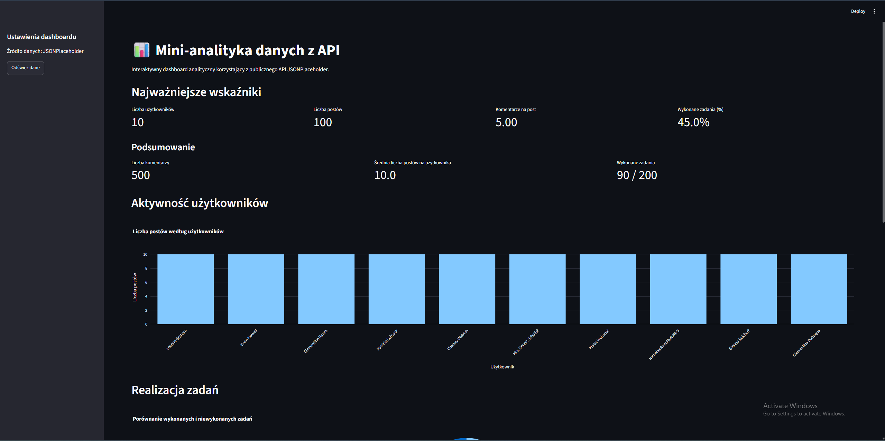
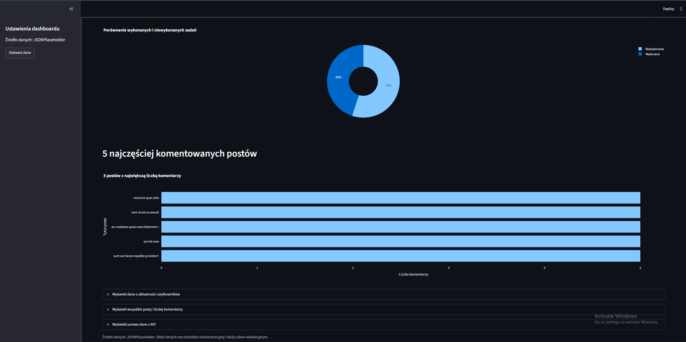

# 📊 Mini-analityka danych z API

## Opis projektu

**Mini-analityka danych z API** to interaktywny dashboard służący do analizy danych pobieranych z publicznego API [JSONPlaceholder](https://jsonplaceholder.typicode.com/).

Aplikacja została napisana w języku Python z wykorzystaniem bibliotek Streamlit, Pandas i Plotly. Pobiera dane dotyczące użytkowników, postów, komentarzy i zadań, a następnie oblicza podstawowe statystyki i przedstawia je w formie wykresów oraz tabel.

### Główne funkcjonalności

- Pobieranie danych z publicznego API JSONPlaceholder.
- Obliczanie podstawowych wskaźników, takich jak liczba użytkowników, postów i komentarzy.
- Analiza aktywności użytkowników.
- Prezentacja procentowego udziału wykonanych zadań.
- Wyświetlanie pięciu postów z największą liczbą komentarzy.
- Wizualizacja danych za pomocą wykresów interaktywnych.
- Przeglądanie szczegółowych tabel z danymi.

## 🛠️ Wykorzystane technologie

- **Python** – język programowania.
- **Requests** – pobieranie danych z API.
- **Pandas** – przetwarzanie i analiza danych.
- **Streamlit** – tworzenie interfejsu aplikacji internetowej.
- **Plotly Express** – tworzenie wykresów interaktywnych.
- **JSONPlaceholder** – źródło danych.

## 📸 Zrzut ekranu aplikacji

Poniżej znajduje się miejsce na zrzut ekranu przedstawiający dashboard z metrykami i wykresami.




Aby wyświetlić zrzut ekranu, należy utworzyć folder `screenshots` w katalogu projektu i zapisać w nim obraz pod nazwą `dashboard.png`.

## 🤖 Wykorzystanie AI

Podczas realizacji projektu korzystałem z narzędzia ChatGPT jako wsparcia w procesie programowania.

AI zostało wykorzystane do:
- pomocy w przygotowaniu i organizacji kodu aplikacji;
- wyjaśniania działania funkcji i fragmentów kodu w Pythonie;
- poprawiania i komentowania kodu;
- pomocy w przygotowaniu wykresów i prezentacji danych;
- tłumaczenia tekstów interfejsu oraz komentarzy na język polski;
- przygotowania dokumentacji projektu w pliku `README.md`.

Wygenerowany kod i proponowane rozwiązania były wykorzystywane jako pomoc edukacyjna. Projekt służył również do poznania sposobu pobierania danych z API, ich analizy oraz prezentowania wyników w aplikacji internetowej.

## ▶️ Uruchomienie projektu

1. Sklonuj repozytorium:

   ```bash
   git clone https://github.com/TWOJ_LOGIN/NAZWA_REPOZYTORIUM.git
   ```

2. Przejdź do katalogu projektu:

   ```bash
   cd NAZWA_REPOZYTORIUM
   ```

3. Zainstaluj wymagane biblioteki:

   ```bash
   pip install -r requirements.txt
   ```

4. Uruchom aplikację:

   ```bash
   streamlit run app.py
   ```

5. Otwórz adres wyświetlony w terminalu, aby korzystać z dashboardu.

## 📂 Struktura projektu

```text
Mini-analityka/
├── app.py
├── analysis.py
├── data.py
├── requirements.txt
├── README.md
└── screenshots/
    └── dashboard.png
```

## 📚 Źródło danych

Dane wykorzystywane w projekcie pochodzą z publicznego API [JSONPlaceholder](https://jsonplaceholder.typicode.com/).

Projekt ma charakter edukacyjny i został stworzony w celu ćwiczenia pobierania, analizy i wizualizacji danych z wykorzystaniem Pythona.